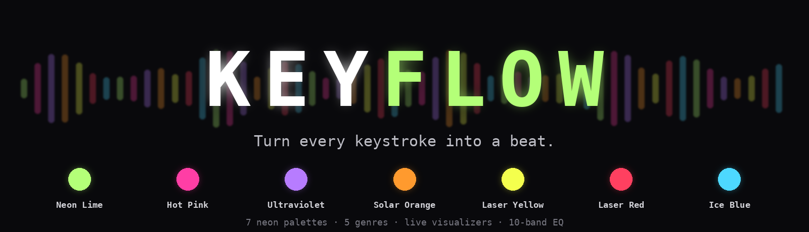
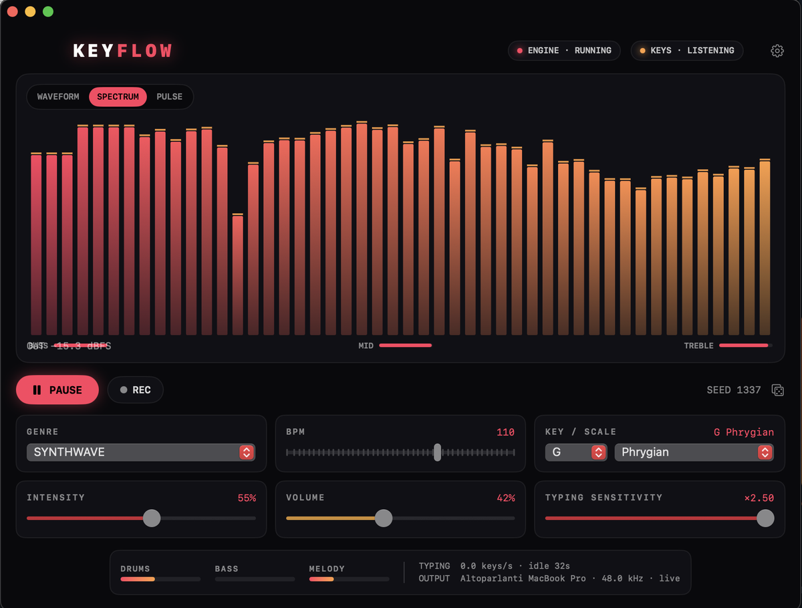
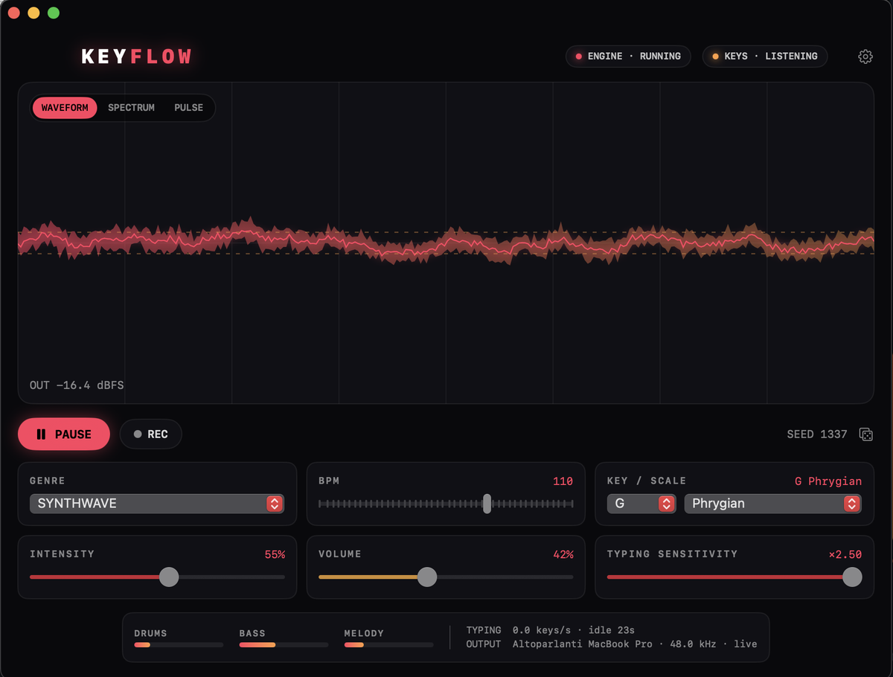
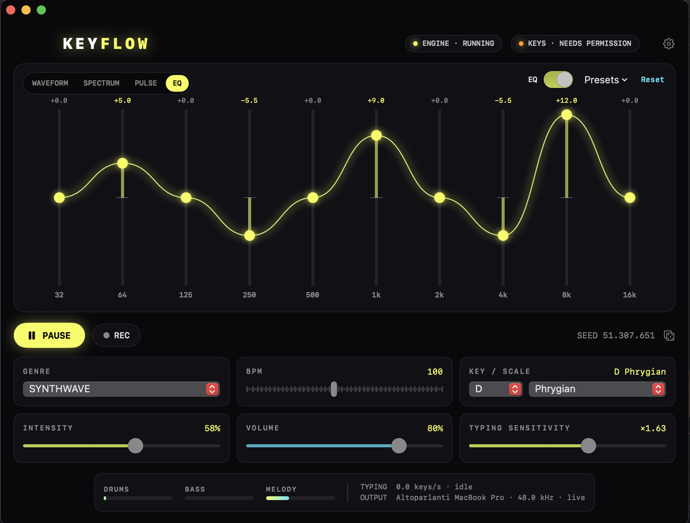

<div align="center">



[](https://ko-fi.com/usualalteration)

   

*Your workflow has a soundtrack.*

</div>

KEYFLOW is a native macOS app (Swift · SwiftUI · AVAudioEngine · Accelerate) that listens to the **timing** of your
typing — in any app: code editor, terminal, chat, documents — and turns it into evolving, always-coherent
electronic music, generated in real time. Nothing is sampled: every sound is synthesized.

## Screenshots

<p align="center">
  
  
</p>

<p align="center">
  
</p>

## Features

- **Procedural synth engine** — kick, snare, hats, FM percussion, bass, lead, arpeggiator, pads, delay, reverb, limiter
- **A new melody every launch** — each start picks a fresh random seed (turn it off in Settings to keep one; seeds can be saved as favorites)
- **Always musical** — scales, chord progressions, quantization, swing; keeps playing on its own when you stop typing
- **5 genres** — Techno, Drum & Bass, Synthwave, Ambient, Experimental
- **Live visualizers driven by the real output signal** — Waveform, Spectrum (FFT), Pulse
- **10-band equalizer tab** — real EQ on the output (32 Hz – 16 kHz, ±12 dB), presets, with the visualizers showing the equalized sound
- **7 neon palettes** — Neon Lime, Hot Pink, Ultraviolet, Solar Orange, Laser Yellow, Laser Red, Ice Blue (switch from the colored dot in the header)
- **Record & export** 24-bit WAV, favorites, reproducible random seeds, audio device selection
- **Menu-bar control** and a built-in uninstaller

## Install

Download `KEYFLOW-universal.dmg` from the [Releases](../../releases) page (runs natively on Intel and Apple Silicon),
open it and drag **KEYFLOW** to **Applications**.

The build is ad-hoc signed, so the first time: right-click the app → **Open**.

On first launch macOS asks for **Input Monitoring** (*System Settings → Privacy & Security → Input Monitoring*).
Grant it and relaunch KEYFLOW. Without it the music still plays, it just won't react to your typing.

## Uninstall

Any of these:

- **From the DMG:** double-click **Uninstall KEYFLOW** (a small app next to KEYFLOW in the disk image).
- **From the app:** menu-bar icon → **Uninstall KEYFLOW…** (also in the app menu and in Settings → About).
- **From Terminal:** `./scripts/uninstall.sh`

All three remove the app, its preferences/caches and its Input Monitoring permission. Exported WAV files are never touched.
(Dragging the app to the Trash also works, but leaves preferences and the permission entry behind.)

## Build from source

Requires macOS 13+ and Xcode or the Command Line Tools (Swift 5.9+).

```bash
git clone https://github.com/usualalteration/KEYFLOW.git
cd KEYFLOW
./scripts/build_dmg.sh        # → dist/KEYFLOW-universal.dmg  (arm64 + x86_64)
```

You can also open `Package.swift` in Xcode and press Run. For a signed/notarized build:

```bash
SIGN_ID="Developer ID Application: Your Name (TEAMID)" NOTARY_PROFILE=my-profile ./scripts/build_dmg.sh
```

Pushing a tag like `v1.1.0` runs `.github/workflows/release.yml`, which builds the DMG and attaches it to the release.

## Privacy

Everything runs locally. Nothing is recorded, logged, stored or sent anywhere.

- The keyboard tap is **listen-only**. Only "a key went down/up" and its timestamp are used
  (the last ~10 seconds are kept in memory). Key codes and typed characters are never read.
- You can switch global monitoring off at any time (header pill, menu-bar item, Settings).

## How typing becomes music

| Typing | Music |
|---|---|
| speed | which layers play (arrangement energy) — **never master volume** |
| bursts | extra hats / percussion / bass notes |
| irregular timing | swing and humanization |
| each key press | a pluck quantized to the next 16th, snapped to the current key/scale |
| a pause | drum fill + crash |
| long inactivity | atmosphere: pads and reverb up, drums thin out — the music never stops |
| resuming after silence | riser |

Every random choice is a pure function of `(seed, bar, step)`, so a seed reproduces the same arrangement.

## Architecture

`KeyboardMonitor` → `TypingRhythmAnalyzer` → `MusicalMappingEngine` → (`HarmonyEngine`, `RhythmEngine`, `AudioScheduler`,
`ProceduralSynthesizer`) → `AudioEngine` → `AudioAnalyzer`/`FFTProcessor` → `Waveform/Spectrum/Pulse` visualizers.
`RecordingManager`, `PresetManager`, `SettingsManager` handle recording, favorites and settings.

The audio render callback never blocks (only a try-lock to fetch parameters), allocates, or does I/O.

## Support

If KEYFLOW makes your day a bit better, you can [buy me a coffee on Ko-fi ☕](https://ko-fi.com/usualalteration).
Issues and pull requests are welcome.

## License

MIT — see [LICENSE](LICENSE).
